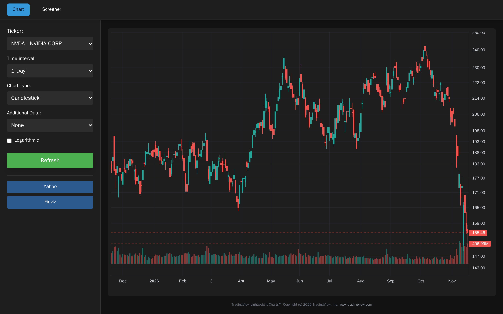
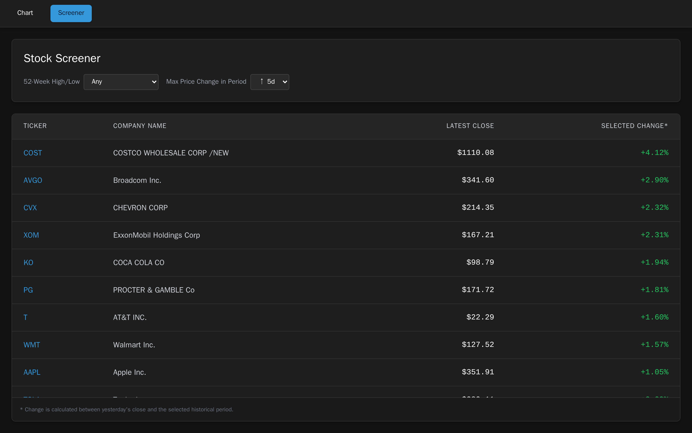
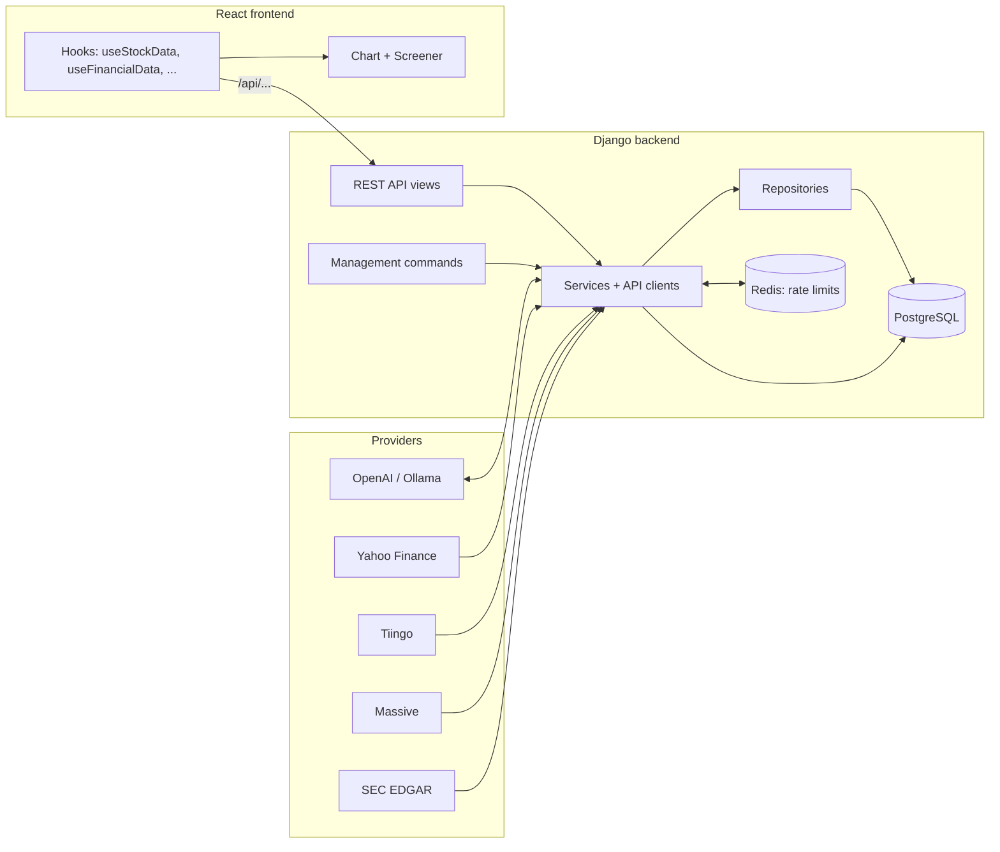

# StockHelper

A full-stack stock analysis platform for self-directed investors: interactive candlestick charts, SEC financial fundamentals, a stock screener and LLM-assisted reading of 10-Q filings.

[](https://github.com/JakubProgrammingWorkspace/ProjectStockHelper/actions/workflows/ci.yml)


[](LICENSE)

> This repository is a public extract of a larger private project; the full commit history lives there.

## Screenshots




## Features

- **Ticker ingestion** from the SEC and Massive APIs (symbol, exchange, CIK, sector, market cap).
- **Historical prices (OHLCV)** from Tiingo and Yahoo Finance (`yfinance`), plus a bulk loader for Massive; refreshable per ticker from the UI.
- **Interactive candlestick charts** (`lightweight-charts`) with 1D / 1W / 1M bundling and revenue / net income overlays.
- **SEC financial data pipeline**: XBRL company facts are fetched, filtered and processed into quarterly and TTM figures.
- **Stock screener** backed by precomputed statistics (`StockScreenerStats`), exposed through a REST endpoint and a dedicated page.
- **LLM analysis of 10-Q filings** through a management command, with OpenAI and Ollama adapters. Results are stored in the database; they are not yet shown in the UI.
- **Rate limiting of external API calls** (SEC, Massive, Tiingo clients) using Redis counters.

## Tech Stack

| Area | Technologies |
|---|---|
| Backend | Python 3.12, Django 5.2, PostgreSQL 16, Redis (`django-redis`), OpenAI API / Ollama, `yfinance` |
| Frontend | React 19, TypeScript, Vite, Tailwind CSS 3, React Router 7, `lightweight-charts` |
| Testing | pytest (+ pytest-django, factory-boy, responses), Vitest + Testing Library + MSW, Playwright |
| Infrastructure | Docker Compose, `uv`, Ruff, GitHub Actions |

Exact versions are pinned in `uv.lock` and `frontend/package.json`.

## Architecture

The backend is one Django app (`apps/stock_data`) organised in layers:

| Layer | Location | Responsibility |
|---|---|---|
| Views | `views.py`, `urls.py` | HTTP only: parse request, call a service, return JSON |
| Services | `services/` | Business logic, grouped by domain (prices, SEC data, tickers, screener, LLM) |
| API clients | `services/api_clients/` | One client per external provider (SEC, Massive, Tiingo) with shared exceptions |
| Repositories | `repositories/` | Data access for screener statistics |
| DTOs | `dto/` | Typed structures for SEC submission data |
| Models | `models/` | Fields, `Meta`, `__str__` only |
| Management commands | `management/commands/` | Entry points for ingestion and processing steps, wired to `make` targets |



**Data flow.** Management commands (or the UI's Refresh button) call services, which fetch data from external providers through the API clients and persist it in PostgreSQL. Redis holds the rate-limit counters used by the API clients. The REST API reads from the database. In the frontend each hook owns one concern (stock data, financial overlays, chart lifecycle, ticker list) and feeds the chart and screener components.

**Design decisions visible in the code**
- Thin views and models, with logic in services.
- One API client per provider, with provider-specific services behind a common base class for price fetching.
- Adapter pattern for LLM providers (`OpenAIClientAdapter`, `OllamaApiAdapter`), so the provider can be switched.
- Repository and DTO classes are used where they pay off (screener statistics, SEC submissions) rather than everywhere.
- Screener statistics are precomputed by a command instead of calculated per request.
- Settings are split into `base` / `dev` / `prod` / `test`, with environment-specific values in `.env`.

## Getting Started

You need Docker (with Compose) and `make`. Follow these steps from a fresh clone.

### 1. Initial setup

1. **Configure the environment.** Open `.env.dist` and set `SEC_EMAIL` and `APP_NAME` (the SEC requires them to identify API clients).
   After `make up`, all environment variables are loaded into the containers. To change them later, edit `.env.dist`, then run `make initialize` (it regenerates `.env`) and `make down && make up`.
2. **Configure providers (optional).** If you have access to providers such as Massive, Tiingo or an LLM, set the API keys in `.env.dist`.
3. **Initialize.** Create `.env` and build the images:
   ```bash
   make initialize
   ```
   **Note:** `make initialize` regenerates `.env` from `.env.dist`; an existing `.env` is backed up to `.env.bak` first.

### 2. Start and initialize the database

1. **Start the containers:**
   ```bash
   make up
   ```
   On macOS, wait a few seconds for the application to start.
2. **Run migrations:**
   ```bash
   make execute-migrations
   ```
3. **Create an admin user (optional):**
   ```bash
   make uv -- run python manage.py createsuperuser
   ```
4. **Fetch tickers:**
   ```bash
   make fetch-tickers
   ```
5. **Open the frontend** at [http://localhost:3000](http://localhost:3000) (or the `FRONTEND_PORT` set in `.env`).
6. **Download prices.** Press **Refresh** in the UI for a single ticker, or load all available tickers:
   ```bash
   make fetch-prices
   ```
   For a quick demo (e.g. screenshots), load one year of prices for 10 well-known stocks (AAPL, MSFT, NVDA, GOOGL, AMZN, META, TSLA, JPM, V, WMT) instead:
   ```bash
   make fetch-demo-prices
   ```
   The screener only needs prices; run step 8 (`update_screener_stats`) afterwards, then pick a filter on the Screener page. It shows no results until at least one filter is selected.
7. **Fetch SEC financial data:**
   ```bash
   make fetch-sec-financial
   ```
8. **Update screener statistics:**
   ```bash
   make uv -- run python manage.py update_screener_stats
   ```

## Running Tests

Backend tests (pytest, in-memory SQLite) and frontend tests (Vitest) cover unit and integration levels; one Playwright smoke spec covers the UI.

```bash
make test            # backend + frontend
make test-backend    # pytest with coverage
make test-frontend   # Vitest
make test-e2e        # Playwright (runs in its own container)
make lint            # Ruff
```

## How It Was Built

This project was built with [Claude Code](https://claude.com/claude-code) as the coding agent. I was responsible for the architecture, requirements, task breakdown, code review and testing. The agent instructions and coding conventions live in `CLAUDE.md` and `.claude/`.

## Disclaimer

StockHelper is for educational purposes only. Nothing in it is investment advice.

## License

Released under the [MIT License](LICENSE).
